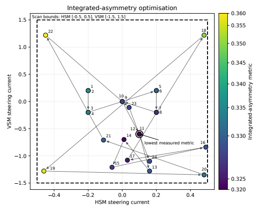

## MuSR Beam Steering



Program to automatically steer beam onto sample in MuSR. This code has capabilities to be generalised to a wide range of settings where various PVs must be scanned over and a certain metric should be minimised.

This project relies on the <https://github.com/TymoteuszTula/PCA_Exp> repo. DOI: <https://doi.org/10.5281/zenodo.4495484>
Relevant files are found in ```musrbeamsteer/TT_PCA```.

Credit to Alex Louat for developing ```gp_kg_minimizer.py```.

## genie-mantid

Uses Mantid for data reduction and processing from NeXus files, a choice of 'metric functions' to quantify goodness of steering,
and a Generic Gaussian-Process + approximate Knowledge-Gradient Bayesian optimisation process to choose the next set of currents for steering magnets.
Uses standard genie python commands for beginning and ending DAE runs.

Would not yet recommend pip installing the package as dependencies are slightly complicated. Mantid must be installed in a mamba env (see <https://www.mantidproject.org/installation/index>) and genie_python pip installed into the same env. Other dependencies can be conda/pip installed at your preference.

Other dependencies:
- numpy
- matplotlib
- scipy
- scikit-learn

Edit user configuration variables in ```musrbeamsteer/genie-mantid/optimised_intergated_gp```. To run genie_python/mantid powered optimiser, from repo root execute ```"python -m musrbeamsteer.genie-mantid.optimised_integrated_gp"```

## bluesky-v1

Bluesky-v1 instead uses the bluesky library for all data acquisition, processing, and interaction with DAE and steering blocks via EPICS. Can be run in entirely synthetic mode, which does not require live IBEX servers and generates purely synthetic asymmetry data. For connection tests, can be run with live motors but synthetic data. Note - bluesky-v1 interfaces with existing DAE/DAE 2 systems which interface with bluesky. This is the standard data acquisition electronics system for MuSR, HIFI, EMU, ARGUS.

Dependencies:
- numpy
- matplotlib
- scipy
- scikit-learn
- pandas
- ophyd_async
- ibex_bluesky_core https://github.com/ISISComputingGroup/ibex_bluesky_core
- bluesky

Edit user configuration in ```musrbeamsteer/bluesky-v1/examples/musr_steering_main```. Then from inside ```musrbeamsteer/bluesky-v1``` execute ```python -m examples.windows_test```.

## bluesky-kafka

Bluesky-kafka will use the new DAQ event-streaming data acquisition system used on SuperMuSR to read current frame data.

## Docs

Docs are a bit of a WIP but can be found at <https://isaac-baulk.github.io/musrbeamsteer/>.

## License

This project is licensed under the GNU General Public License v3.0 (GPLv3) - see the [LICENSE](LICENSE) file for details. 
